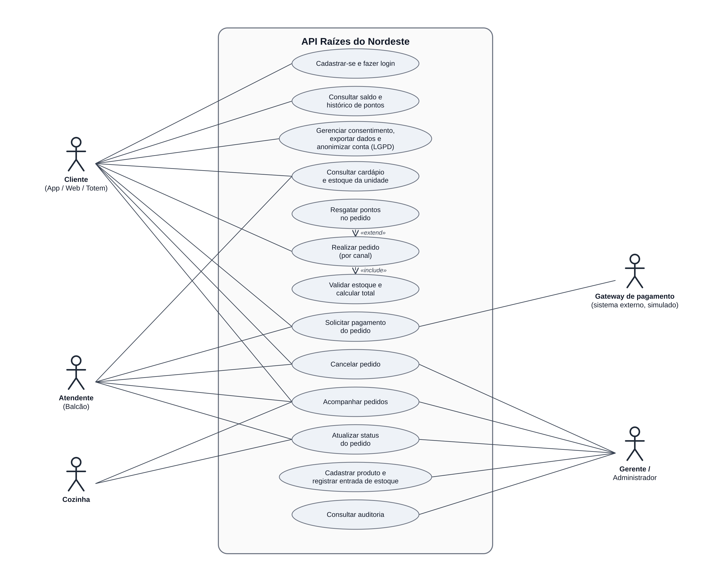
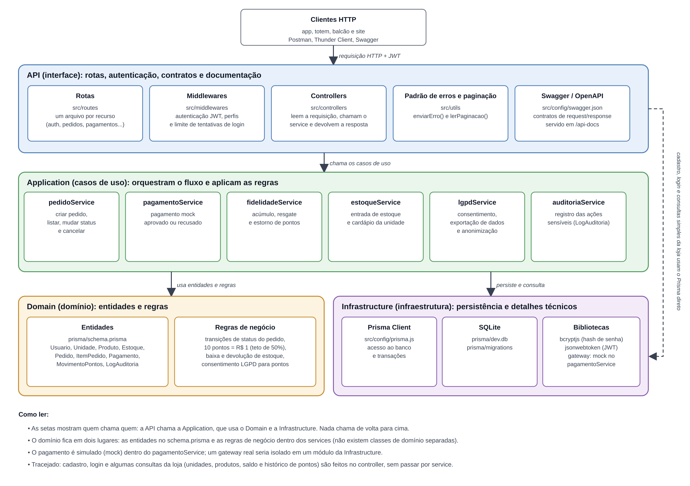
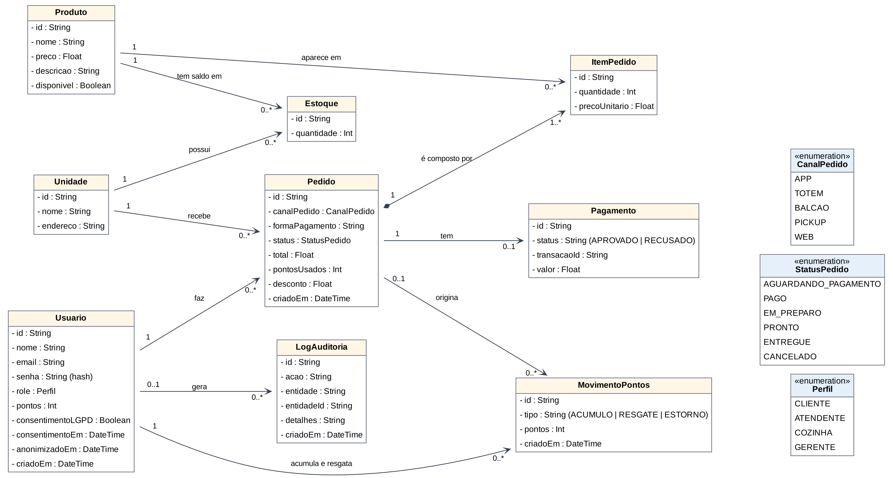
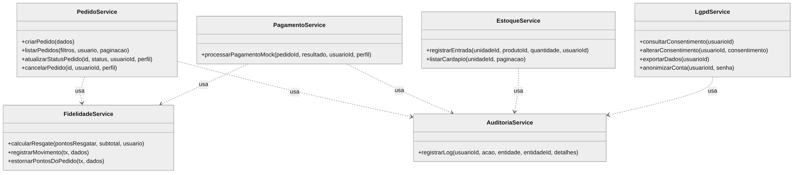
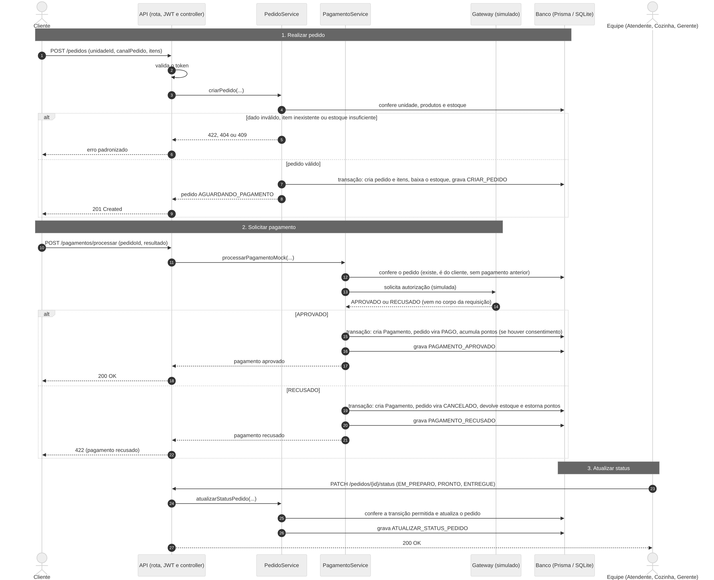
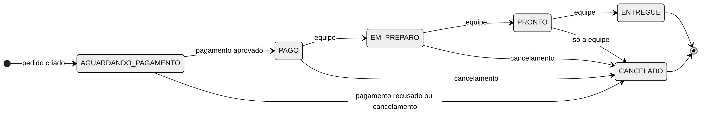

# Arquitetura e diagramas

Este documento reúne os diagramas da API Raízes do Nordeste e explica como eles se ligam ao código e aos endpoints. Todas as imagens estão em `docs/diagramas/`, junto com os arquivos de origem (`.svg`, `.mmd` e `.dot`). O modelo de dados (DER) está em [DER-raizes-do-nordeste.pdf](DER-raizes-do-nordeste.pdf), e as regras e prioridades em [requisitos.md](requisitos.md).

## 1. Casos de uso

### Atores

| Ator | O que faz na API | Perfil no código |
|------|------------------|------------------|
| Cliente (app, web ou totem) | Cadastra-se, faz pedidos, paga, acompanha e cancela os próprios pedidos, usa os pontos e exerce os direitos da LGPD | `CLIENTE` |
| Atendente (balcão) | Consulta cardápio e pedidos, registra o pagamento, atualiza o status e cancela pedidos | `ATENDENTE` |
| Cozinha | Consulta os pedidos e atualiza o status (preparo, pronto, entregue) | `COZINHA` |
| Gerente / Administrador | Tudo o que a equipe faz, mais cadastro de produto, entrada de estoque e consulta de auditoria | `GERENTE` |
| Gateway de pagamento | Sistema externo que aprova ou recusa o pagamento. No projeto ele é **simulado** (mock) | não é um usuário da API |

Observações:

- O cadastro em `POST /auth/cadastro` sempre cria uma conta `CLIENTE`. Os outros perfis existem no código e no controle de acesso, mas o seed só cria um cliente e um gerente.
- No código, `ATENDENTE` e `COZINHA` têm exatamente as mesmas permissões na rota de status. A diferença entre os dois é de papel no negócio, e não de regra técnica.
- Qualquer usuário autenticado pode abrir um pedido, mas ele sempre fica no nome de quem fez a requisição. Não existe, nesta versão, "pedido de balcão em nome de outro cliente".

### Casos de uso e endpoints

| Caso de uso | Quem usa | Endpoints |
|-------------|----------|-----------|
| Cadastrar-se e fazer login | Cliente (todos os perfis fazem login) | `POST /auth/cadastro`, `POST /auth/login` |
| Consultar cardápio e estoque | Cliente, Atendente, Gerente | `GET /unidades`, `GET /unidades/{id}/cardapio`, `GET /produtos` (públicos), `GET /estoque/{unidadeId}` (logado) |
| Realizar pedido (por canal) | Cliente | `POST /pedidos` |
| Resgatar pontos no pedido | Cliente (extensão do pedido) | campo `pontosResgatar` em `POST /pedidos` |
| Solicitar pagamento | Cliente, Atendente, Gateway | `POST /pagamentos/processar` |
| Acompanhar pedidos | Cliente (só os seus), equipe (todos) | `GET /pedidos` com `canalPedido`, `status`, `pagina` e `limite` |
| Atualizar status do pedido | Atendente, Cozinha, Gerente | `PATCH /pedidos/{id}/status` |
| Cancelar pedido | Cliente (até `EM_PREPARO`), equipe (até `PRONTO`) | `PATCH /pedidos/{id}/cancelar` |
| Consultar saldo e histórico de pontos | Cliente | `GET /fidelidade/saldo`, `GET /fidelidade/historico` |
| Consentimento, exportação e anonimização (LGPD) | Cliente | `GET` e `PATCH /lgpd/consentimento`, `GET /lgpd/meus-dados`, `POST /lgpd/anonimizar` |
| Cadastrar produto e registrar entrada de estoque | Gerente | `POST /produtos`, `POST /estoque` |
| Consultar auditoria | Gerente | `GET /auditoria` |

### Descrição de feature: Realizar pedido e solicitar pagamento

Esta é a funcionalidade crítica do sistema. Ela junta estoque, fidelidade, pagamento e auditoria.

| Item | Descrição |
|------|-----------|
| Atores | Cliente (principal); Gateway de pagamento (secundário, simulado) |
| Pré-condições | Cliente autenticado com token JWT válido; unidade existente; produtos disponíveis com estoque na unidade |
| Gatilho | O cliente envia `POST /pedidos` |

**Fluxo principal**

1. O cliente envia a unidade, o canal (`APP`, `TOTEM`, `BALCAO`, `PICKUP` ou `WEB`) e a lista de itens com a quantidade de cada um.
2. A API valida o token, o canal, os campos e o tipo dos dados.
3. A API confere se a unidade existe e, para cada item, se o produto existe, está disponível e tem estoque na unidade.
4. Em uma única transação, a API cria o pedido com os itens, grava o preço de cada produto no momento da compra, baixa o estoque e registra `CRIAR_PEDIDO` na auditoria.
5. A API responde `201` com o pedido em `AGUARDANDO_PAGAMENTO`.
6. O cliente envia `POST /pagamentos/processar` com o `pedidoId` e o `resultado` (`APROVADO` ou `RECUSADO`).
7. O resultado informado faz o papel da resposta do gateway. Se for aprovado, a API cria o pagamento com um `transacaoId` `MOCK-...`, muda o pedido para `PAGO` e, se o cliente tiver dado consentimento, acumula 1 ponto por real pago.
8. A API registra `PAGAMENTO_APROVADO` na auditoria e responde `200`.
9. A equipe leva o pedido adiante com `PATCH /pedidos/{id}/status` (`EM_PREPARO`, `PRONTO`, `ENTREGUE`), e cada mudança também vai para a auditoria.

**Fluxos alternativos e exceções**

| Situação | Resposta |
|----------|----------|
| Sem token ou token inválido | `401` `NAO_AUTENTICADO` ou `TOKEN_INVALIDO` |
| Canal ausente ou inválido | `422` `CANAL_INVALIDO` |
| Campos obrigatórios ausentes, tipo errado, quantidade zero ou negativa | `422` `DADOS_INVALIDOS` ou `ITEM_INVALIDO` |
| Mesmo produto repetido no pedido | `422` `ITEM_DUPLICADO` |
| Unidade inexistente | `404` `UNIDADE_NAO_ENCONTRADA` |
| Produto inexistente ou indisponível | `404` `PRODUTO_NAO_ENCONTRADO` |
| Estoque insuficiente | `409` `ESTOQUE_INSUFICIENTE`, sem criar pedido nem baixar nada |
| Resgate de pontos inválido ou acima do saldo ou do limite | `422` `PONTOS_INVALIDOS`, `PONTOS_INSUFICIENTES` ou `DESCONTO_ACIMA_DO_LIMITE` |
| Resgate sem consentimento LGPD | `403` `CONSENTIMENTO_NECESSARIO` |
| Pagamento de pedido de outra pessoa | `403` `SEM_PERMISSAO` |
| Pagamento de pedido inexistente | `404` `PEDIDO_NAO_ENCONTRADO` |
| Pagamento negado | `422` com o pagamento `RECUSADO`; o pedido vai para `CANCELADO`, o estoque volta e os pontos são estornados |
| Pagamento repetido para o mesmo pedido | `409` `PAGAMENTO_JA_PROCESSADO` |

**Pós-condições**

- Pagamento aprovado: pedido `PAGO`, pagamento gravado, pontos acumulados (se houver consentimento) e dois registros de auditoria (`CRIAR_PEDIDO` e `PAGAMENTO_APROVADO`).
- Pagamento recusado: pedido `CANCELADO`, estoque e pontos devolvidos, e registros `CRIAR_PEDIDO` e `PAGAMENTO_RECUSADO`.
- Erro de validação: nada é gravado.

**Regras de negócio**

- O preço do item é copiado para o pedido (`precoUnitario`), então mudar o preço depois não altera pedidos antigos.
- Estoque é por unidade. A baixa acontece na criação do pedido, e cancelamento ou pagamento recusado devolvem os itens.
- Fidelidade: 1 ponto por R$ 1 do valor pago (já com o desconto) e só com consentimento. Cada 10 pontos valem R$ 1 de desconto, limitado a 50% do subtotal.
- Cada pedido tem no máximo um pagamento (`Pagamento.pedidoId` é único).
- **Idempotência:** a API não usa chave de idempotência. A proteção é o bloqueio de um segundo pagamento para o mesmo pedido (`409`). Ela não cobre duas requisições simultâneas no mesmo instante, que é uma limitação já listada no README.

## 2. Arquitetura em camadas

O projeto segue uma arquitetura em camadas (estilo MVC com uma camada de serviços). O mapeamento para as quatro camadas pedidas é este:

| Camada | Onde fica | Responsabilidade |
|--------|-----------|------------------|
| API (interface) | `src/routes`, `src/middlewares`, `src/controllers`, `src/utils`, `src/config/swagger.json` | Rotas, autenticação JWT, controle por perfil, limite de tentativas de login, formato das requisições e respostas, erros padronizados e documentação Swagger |
| Application | `src/services` | Casos de uso: criar pedido, mudar status, cancelar, pagamento mock, fidelidade, estoque, LGPD e auditoria |
| Domain | `prisma/schema.prisma` e regras dentro de `src/services` | Entidades e regras: transições de status, pontos, desconto máximo, baixa de estoque, consentimento |
| Infrastructure | `src/config/prisma.js`, `prisma/migrations`, SQLite, `bcryptjs`, `jsonwebtoken` | Persistência, transações e detalhes técnicos |

Pontos que vale deixar claros:

- **O domínio está em dois lugares.** As entidades ficam no `schema.prisma`, e as regras de negócio ficam dentro dos services. Não criei classes de domínio separadas. A separação entre "o que é a regra" e "como se grava" existe, mas é mais enxuta do que em um DDD completo.
- **O pagamento mock fica no `pagamentoService`.** Para trocar por um gateway real, a chamada externa seria isolada em um módulo da infraestrutura e o service só receberia o resultado.
- **Nem tudo passa por service.** Cadastro, login e algumas consultas da loja (unidades, produtos, saldo e histórico de pontos) usam o Prisma direto no controller, porque não têm regra de negócio além da validação. Tudo o que envolve pedido, pagamento, estoque, LGPD e auditoria passa por service.

## 3. Diagrama de classes

### Visão de domínio

As classes correspondem aos modelos do `schema.prisma` e às tabelas do DER. Os valores de `Perfil`, `StatusPedido` e `CanalPedido` aparecem como enumerações para facilitar a leitura, mas no banco ficam guardados como texto e são validados na API.

| Classe | Papel |
|--------|-------|
| `Usuario` | Cliente ou equipe, com perfil, saldo de pontos, consentimento e data de anonimização |
| `Unidade` | Loja física. Cada uma tem estoque e pedidos próprios |
| `Produto` | Item do cardápio, com preço e disponibilidade |
| `Estoque` | Quantidade de um produto em uma unidade (par único `unidadeId` + `produtoId`) |
| `Pedido` | Compra de um cliente em uma unidade, por um canal, com status, total, desconto e pontos usados |
| `ItemPedido` | Linha do pedido, com a quantidade e o preço no momento da compra |
| `Pagamento` | Resultado do pagamento do pedido. Fica separado do pedido (desacoplado) e é único por pedido |
| `MovimentoPontos` | Histórico da fidelidade: `ACUMULO`, `RESGATE` e `ESTORNO` |
| `LogAuditoria` | Registro de quem fez o quê e quando |

### Visão da camada de aplicação

Os comportamentos do sistema ficam nos services, e não nas classes de domínio. O diagrama mostra os métodos reais de cada service e quem usa quem. Todos acessam o banco pelo Prisma, diretamente ou pela transação que recebem.

## 4. Diagrama de sequência do fluxo crítico

O diagrama cobre o fluxo Pedido → Pagamento → Atualização de status, com os caminhos de erro na criação do pedido e os dois resultados do pagamento. Na simulação, o resultado do gateway chega no corpo da requisição (`resultado`).

## 5. Estados do pedido

| De | Para | Quem pode |
|----|------|-----------|
| `AGUARDANDO_PAGAMENTO` | `PAGO` | Pagamento aprovado |
| `AGUARDANDO_PAGAMENTO` | `CANCELADO` | Pagamento recusado, cliente ou equipe |
| `PAGO` | `EM_PREPARO` | Equipe |
| `PAGO` | `CANCELADO` | Cliente ou equipe |
| `EM_PREPARO` | `PRONTO` | Equipe |
| `EM_PREPARO` | `CANCELADO` | Cliente ou equipe |
| `PRONTO` | `ENTREGUE` | Equipe |
| `PRONTO` | `CANCELADO` | Só a equipe (o cliente recebe `409` `PEDIDO_NAO_CANCELAVEL`) |
| `ENTREGUE`, `CANCELADO` | nenhum | Estados finais |

Qualquer outra mudança responde `409` `TRANSICAO_INVALIDA`.

## 6. Como os diagramas se ligam aos endpoints

| Diagrama | Liga com |
|----------|----------|
| Casos de uso | Cada caso de uso corresponde a um grupo de endpoints (seção 1). O perfil do ator define quais rotas ele consegue chamar |
| DER e classes | Cada classe é uma tabela. As rotas de pedido, pagamento, fidelidade, estoque e auditoria leem e gravam essas tabelas por meio dos services |
| Camadas | Rota → controller → service → Prisma. O caminho de uma requisição segue a seta do diagrama de camadas |
| Sequência e estados | Mostram o fluxo entregue: `POST /pedidos`, `POST /pagamentos/processar` e `PATCH /pedidos/{id}/status` |

Os cenários que comprovam esse fluxo estão no [plano de testes](plano-de-testes.md).
